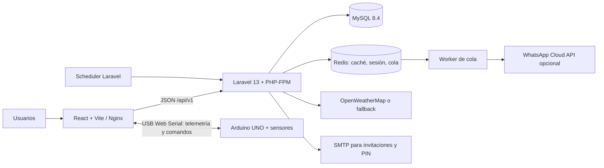

# Informe integral del proyecto YakuAI

**Fecha de elaboración:** 22 de noviembre de 2026  
**Base del informe:** documentación, configuración y código presentes en el repositorio de YakuAI en la fecha indicada.  
**Propósito:** servir como dossier funcional y técnico para preparar un informe completo del proyecto.

> **Alcance y cautela:** el documento sintetiza la evidencia disponible en el repositorio. La existencia de una función o de una prueba automatizada no demuestra por sí sola que haya sido ejecutada, que un proveedor externo esté configurado o que el sistema haya sido validado en campo. Se excluyeron los valores privados del archivo `.env`; las credenciales, tokens, códigos de acceso y datos personales no deben copiarse a una versión pública de este informe.

## 1. Resumen ejecutivo

YakuAI es una aplicación web para apoyar decisiones de riego en agricultura familiar. Relaciona agricultores, parcelas, cultivo y etapa fenológica, textura de suelo, lecturas de sensores y pronóstico meteorológico. Un motor en el backend produce una evaluación explicable: recomienda regar, no regar, esperar por lluvia o completar la evaluación cuando falten datos válidos. También propone un volumen y un horario cuando recomienda riego.

La solución tiene un frontend React/TypeScript, una API Laravel/PHP, una base MySQL y servicios de soporte como Redis, correo SMTP y OpenWeatherMap. Incluye una maqueta física con Arduino UNO, sensores y una bomba pequeña. El frontend se comunica con el Arduino por USB usando Web Serial: recibe telemetría y contiene un flujo para enviar órdenes de activación y detención de la bomba. El Arduino conserva controles locales, entre ellos un flotador y un límite de cinco segundos por activación.

El sistema registra los riegos realizados y mantiene historial de correcciones y anulaciones. Las alertas se calculan al consultar la API. El envío automático de WhatsApp es opcional y depende de credenciales, cola y worker; compartir un texto desde la interfaz es una acción manual distinta.

YakuAI está diseñado para recomendar y demostrar un flujo de riego. Los valores iniciales agronómicos, la calibración de sensores, el comportamiento del hardware y la precisión de las recomendaciones necesitan validación local antes de utilizarse como asesoramiento agronómico operativo. La maqueta representa un flujo a escala y no acredita el desempeño de un sistema instalado en parcelas reales.

## 2. Identidad, problema y alcance del producto

### 2.1 Necesidad que aborda

La decisión de regar requiere interpretar señales que normalmente están dispersas: humedad del suelo, cultivo y etapa, propiedades estimadas del suelo, tamaño de parcela, eficiencia y sistema de riego, lluvia prevista y registro de acciones previas. YakuAI reúne esos datos, calcula una recomendación con razones visibles y permite conservar el historial para agricultores y personal técnico.

### 2.2 Objetivos funcionales

- Organizar agricultores, cuentas, parcelas, cultivos, suelos y sensores.
- Capturar lecturas manuales, telemetría serial del Arduino y datos de demostración.
- Consultar y actualizar pronósticos meteorológicos, señalando el origen de los datos.
- Calcular recomendaciones de riego con entradas y parámetros conservados en un snapshot.
- Mostrar el resultado, el motivo, la cantidad estimada y el horario/plan propuesto.
- Registrar riegos realizados y conservar la trazabilidad de correcciones y anulaciones.
- Presentar alertas, métricas operativas y escenarios deterministas de validación.
- Dar a cada agricultor acceso limitado a su información mediante invitación y PIN.

### 2.3 Alcance y límites

- El sistema **apoya una decisión**; el motor backend no envía una orden de riego como parte del cálculo agronómico.
- La integración actual de Arduino sí tiene un flujo separado de control de bomba desde el navegador. Está dirigido al técnico y a la maqueta conectada; no convierte la aplicación en un controlador remoto de campo.
- El caudalímetro y la bomba de la maqueta no acreditan que el volumen recomendado para una parcela real se haya aplicado. El volumen de la maqueta es aproximado y de escala.
- Los escenarios demo usan entradas sintéticas; sirven para recorrer la interfaz y verificar reglas deterministas, no para demostrar precisión agronómica.
- OpenWeatherMap, SMTP y WhatsApp necesitan una configuración externa funcional. Los fallbacks o simulaciones deben mostrarse como tales.
- La distribución del repositorio no incluye evidencia suficiente para afirmar que se realizó una validación agronómica en campo o una auditoría formal de accesibilidad.

## 3. Personas usuarias, roles y recorridos

| Rol | Uso previsto | Acceso de interfaz observado |
|---|---|---|
| Agricultor | Revisar sus parcelas, ver avisos y evaluaciones, consultar y registrar sus riegos. | Hoy, Evaluar, Mis riegos y Alertas de sus parcelas. Inicia con correo y PIN de cuatro dígitos. |
| Técnico | Operar el panel, mantener datos de campo, sensores y cuentas agricultoras; evaluar y validar. | Resumen, Evaluar, Riegos, Alertas, Sensores, Clima, Parcelas, Agricultores, Catálogos y Validación. |
| Administrador | Tareas del personal y administración de cuentas de usuario. | Comparte navegación técnica; gestión de usuarios existe en API, sin pantalla frontend dedicada identificada. |

La interfaz oculta opciones según el rol, pero la autorización real debe aplicarse en API, solicitudes y controladores. Las rutas frontend conocidas son `/` (resumen/Hoy), `/evaluar`, `/riegos`, `/alertas`, `/sensores`, `/clima`, `/parcelas`, `/agricultores`, `/catalogos`, `/validacion`, `/login`, `/recuperar-pin` y `/activar-cuenta`.

### 3.1 Flujo de agricultor

1. El técnico crea o habilita la cuenta a través de una invitación por correo.
2. El agricultor activa la cuenta y define un PIN de cuatro dígitos.
3. En **Hoy** consulta el estado de sus parcelas y avisos.
4. En **Evaluar** selecciona una parcela. La evaluación real requiere humedad válida reciente y pronóstico vigente.
5. Si el resultado recomienda regar, revisa motivo, litros, plan y hora propuesta. La recomendación no registra por sí sola un riego realizado.
6. Después de actuar en el campo, registra el riego en **Mis riegos**. Una corrección agrega un registro sucesor; una anulación conserva el motivo.
7. Puede consultar alertas y compartir manualmente el resumen generado.

### 3.2 Flujo técnico y demostración

El personal técnico administra parcelas, agricultores, sensores y configuración de la maqueta; revisa clima, alertas, métricas, catálogos y validación. En Evaluar puede utilizar escenarios demo sin guardar la evaluación ni mediciones. El flujo físico de Arduino requiere navegador compatible, USB, telemetría reciente y las salvaguardas que se detallan en la sección 9.

## 4. Arquitectura y tecnologías



### 4.1 Tecnologías principales

| Área | Tecnologías/configuración observadas |
|---|---|
| Frontend | React 19, TypeScript, Vite, React Router, Tailwind CSS, Leaflet, Recharts, React Hook Form y componentes Radix/shadcn adaptados. |
| Backend | PHP 8.3, Laravel 13, Eloquent, Laravel Sanctum, PHPUnit y Laravel Pint. API JSON versionada bajo `/api/v1`. |
| Persistencia | MySQL 8.4; migraciones Laravel y seeders. |
| Caché, sesión y cola | Redis 7; stores seleccionables por configuración; Redis se usa en la composición de producción. |
| Contenedores | Docker Compose; imágenes para PHP-FPM, Nginx de API y frontend. Compose local monta el código; el de producción compila imágenes sin montar código del host. |
| Hardware | Sketch Arduino C++ con OneWire y DallasTemperature; conexión USB serial a 9600 baudios y Web Serial API del navegador. |
| Integraciones | OpenWeatherMap; correo SMTP; WhatsApp Cloud API opcional. |

### 4.2 Organización del repositorio

- `frontend/src/app/`: sesión, rutas, autorización de navegación y arranque.
- `frontend/src/api/`: tipos, cliente HTTP y endpoints.
- `frontend/src/features/`: módulos de evaluación, agricultores, parcelas, riegos, clima, sensores, alertas, catálogos, validación, Hoy y dashboard.
- `frontend/src/pages/`: composición de pantallas y pruebas de páginas.
- `frontend/src/design-system/`, `components/` y `styles/`: tokens, primitivas, componentes reutilizables, layouts y estilos.
- `backend/app/Http/Controllers/` y `Requests/`: endpoints, validación y autorización de solicitudes.
- `backend/app/Models/`: entidades Eloquent.
- `backend/app/Services/`: cálculo hídrico, normalización de sensores, clima, validación, métricas e integración de mensajería.
- `backend/app/Jobs/`, `app/Console/Commands/` y `routes/console.php`: cola y tareas periódicas.
- `backend/database/`: migraciones, factories y seeders.
- `backend/tests/`: pruebas de unidad y funcionales.
- `hardware/arduino/`: sketch de la maqueta.
- `docker/` y archivos `docker-compose*.yml`: imágenes y configuración local/producción.
- `docs/`: guías de producto, arquitectura, backend, frontend, integraciones, operación y referencias.
- `scripts/`: configuración inicial y comprobaciones.
- `.github/workflows/`: automatización CI documentada en el repositorio.

## 5. Interfaz y experiencia visual

El frontend implementa pantallas separadas por dominio y componentes compartidos para formularios, tablas, filtros, tarjetas de métricas, gráficos, alertas, diálogos y estados vacíos/de carga. Los módulos principales incluyen dashboard/Hoy, Evaluación, Parcelas, Agricultores, Sensores, Clima, Riegos, Alertas, Catálogos y Validación.

La identidad visual utiliza teal principal `#0B6672`, fondo `#F4F7F5`, superficies blancas y colores semánticos para éxito, advertencia, información y error. La tipografía preferida es Inter con fallbacks del sistema. El espaciado base sigue múltiplos de 4 px; el tamaño táctil general de referencia es 44 px y existe modo de campo con objetivos mayores. Las primitivas se encuentran bajo `frontend/src/design-system/`; parte de la definición de tokens también existe en CSS global y `src/lib/theme.ts`.

La interfaz usa layouts adaptables, foco visible, etiquetas, estados de carga/error y respeta `prefers-reduced-motion`. Esto no equivale a certificación WCAG. La documentación recomienda QA manual con teclado, contraste y anchos de 320, 360, 390, 768, 1024 y 1280 px. `frontend/qa-preview.html` es una vista de revisión visual basada en fixtures locales, no una pantalla de producción ni un medio de persistencia.

## 6. Datos y modelo de dominio

Las migraciones en `backend/database/migrations/` son la fuente de verdad del esquema. El modelo se compone de:

| Entidad | Información/relaciones |
|---|---|
| Usuario (`users`) | Nombre, correo, contraseña/PIN cifrados, rol, estado activo, teléfono y vínculo opcional con agricultor; usa tokens Sanctum. |
| Agricultor (`farmers`) | Nombre, teléfono y estado; agrupa parcelas y puede relacionarse con una cuenta agricultor. |
| Invitación (`farmer_invitations`) | Usuario, correo, hash de token, vencimiento y aceptación. El token no debe documentarse en claro. |
| Parcela (`plots`) | Agricultor, coordenadas, polígono opcional, área y origen, cultivo, fecha de siembra, textura, sistema/eficiencia de riego, caudal y estado. |
| Cultivo / Etapa (`crops`, `crop_stages`) | Catálogo y valores de etapa: duración, Kc, profundidad radicular, agotamiento, versión y procedencia. |
| Textura (`soil_textures`) | Catálogo con capacidad de campo (CC), punto de marchitez permanente (PMP), fuente, fecha de revisión y versión. |
| Sensor (`sensors`) | Parcela, tipo, modelo, pin, referencias seco/húmedo, estado y actividad. Tiene mediciones e indicador de última lectura. |
| Medición (`measurements`) | Sensor y parcela, fecha, valor crudo/normalizado, calidad y origen. La unicidad por sensor/fecha evita duplicados. |
| Pronóstico (`forecasts`) | Parcela, periodo, fecha de consulta/emisión, temperaturas, lluvia, probabilidad, payload original y origen. |
| Evaluación (`evaluations`) | Parcela, fecha, etapa, resultado, rango de litros, confianza, razón, próxima revisión, criticidad y snapshot de entradas/parámetros. |
| Riego (`irrigations`) | Parcela, evaluación opcional, hora, volumen recomendado/aplicado, origen, nota y estado; los sucesores apuntan al registro corregido. |
| Auditoría (`audit_logs`) | Acción, modelo afectado, usuario, IP y detalles estructurados. |
| Tokens, cache y jobs | Tablas Laravel de tokens personales, caché/locks y trabajos según migraciones/framework. |

Las eliminaciones se limitan por relaciones y claves foráneas. La interfaz no ofrece borrado general de los recursos operativos principales. Los registros y snapshots facilitan reconstruir por qué se produjo una evaluación.

### 6.1 Catálogos iniciales

El `CatalogSeeder` incluye papa, maíz choclo, haba seca y zanahoria, cada uno con etapas `ini`, `des`, `med` y `fin`, duraciones y parámetros de Kc, raíces y agotamiento. Sus referencias declaradas son FAO-56 tablas 12 y 22; las duraciones son estimaciones provisionales. Las texturas incluidas son arenoso, franco arenoso, franco, franco arcilloso y arcilloso, con CC/PMP provisionales atribuidos a FAO-56 tabla 19 y Saxton & Rawls (2006). El propio seeder indica que faltan mediciones y validación agronómica local.

El seeder de simulación genera registros identificados con nombres `Sim ...`: tres agricultores, cuatro parcelas, sensores/mediciones y pronósticos demo. No son usuarios ni parcelas reales y esos registros no constituyen prueba de campo.

## 7. API y servicios backend

La API se encuentra bajo `/api/v1`. Las rutas de salud y ciertos flujos de autenticación/activación/recuperación son públicas con límites de frecuencia; la mayoría de recursos exige Sanctum y middleware `yakuai`.

| Método y ruta | Uso |
|---|---|
| `GET /health` | Salud del API. |
| `POST /auth/login` | Inicio de sesión unificado por correo y secreto. |
| `POST /auth/activate-farmer` | Aceptar invitación y activar cuenta de agricultor. |
| `POST /auth/recover-pin`, `POST /auth/reset-pin` | Envío y uso de código de recuperación. |
| `GET /auth/me`, `POST /auth/logout`, `POST /auth/refresh` | Sesión actual, cierre y renovación del token. |
| `GET/POST /users`, `GET/PATCH /users/{user}` | Gestión de usuarios, reservada según rol. |
| `GET/POST /farmers`, `GET/PATCH /farmers/{farmer}`, `POST /farmers/{farmer}/invitation` | Agricultores e invitaciones. |
| `GET/POST /plots`, `GET/PATCH /plots/{plot}` | Parcelas. |
| `GET/POST /sensors`, `GET/PATCH /sensors/{sensor}`, `POST /sensors/{sensor}/simular` | Sensores y simulación de lectura. |
| `POST /plots/{plot}/arduino/configure` | Crear/reutilizar el conjunto fijo de sensores de la maqueta de forma idempotente. |
| `GET/POST /measurements` | Consultar/ingresar mediciones. Duplicados pueden responder 409; sensor inactivo, 422. |
| `GET /crops`, `GET /crops/{crop}`, `GET /soil-textures`, `GET /soil-textures/{soilTexture}` | Catálogos en consulta. |
| `GET /plots/{plot}/weather`, `POST /plots/{plot}/weather/refresh` | Pronóstico vigente y actualización. |
| `POST /plots/{plot}/evaluate` | Crear o recuperar la evaluación de la hora vigente. |
| `POST /plots/{plot}/evaluate-demo` | Evaluación ficticia para técnico/admin sin guardar evaluación/mediciones/pronóstico; entradas `humedad_pct`, `rain_mm` y `rain_prob`. |
| `GET /evaluations`, `GET /evaluations/{evaluation}`, `GET /evaluations/{evaluation}/mensaje` | Consultar evaluación y generar texto compartible. |
| `GET/POST /irrigations`, `POST /irrigations/{riego}/corregir`, `POST /irrigations/{riego}/anular` | Historial, registro, corrección y anulación de riego. |
| `GET /alerts`, `GET /validation` | Alertas calculadas y matriz de escenarios. |
| `GET /metrics/summary`, `/metrics/evaluations`, `/metrics/sensors` | Resumen y métricas operativas. |

`GET /user` aparece como ruta auxiliar heredada del esqueleto Laravel. Para payloads, filtros y códigos de error exactos prevalecen controladores, requests y pruebas funcionales.

### 7.1 Servicios

- `HydroService`: etapa de cultivo, cálculo de ET, humedad/umbral, resultado, volumen y plan.
- `SensorNormalizer`: convierte valores crudos a normalizados y clasifica anomalías.
- `OwmService`: consulta OpenWeatherMap y registra pronóstico real o fallback etiquetado.
- `ValidationService`: ejecuta una matriz de diez casos en memoria, sin persistirlos.
- `MetricsService`: agrega métricas del panel.
- `FarmerInvitationService`: ciclo de invitaciones.
- `MessageService` y `WhatsAppService`: texto y envío externo; `SendWhatsAppMessage` procesa la cola.

## 8. Motor de recomendación hídrica

El motor está implementado en `backend/app/Services/HydroService.php`. Cada evaluación conserva en `inputs_snapshot` los parámetros y valores utilizados, para que el resultado pueda explicarse aunque los catálogos cambien después.

### 8.1 Requisitos de entrada y vigencia

- Lectura de humedad con calidad `ok`, de hasta 30 minutos.
- Pronóstico consultado en los últimos 180 minutos.
- Parcela con cultivo/etapas y textura existentes.
- El controlador intenta refrescar el pronóstico si no existe o supera 120 minutos.
- Sin humedad válida: resultado `incompleta`, razón `sin_humedad_valida`, revisión en una hora.
- Sin clima válido: resultado `incompleta`, razón `sin_clima_valido`, revisión en una hora.

### 8.2 Cálculos y reglas

1. **Etapa:** se calcula desde la fecha de siembra acumulando los días configurados por etapa. Si se excede la suma, se usa la última etapa.
2. **Evapotranspiración:** se estima radiación extraterrestre según FAO-56 y ET₀ con Hargreaves; ETc = ET₀ × Kc. Si faltan máximas/mínimas del aire, se suponen 24 °C y 12 °C y se anota `temp_asumida` en el snapshot. ETc se conserva como contexto; no decide por sí sola el resultado actual.
3. **Humedad estimada:** el sensor capacitivo es índice relativo 0–100, no humedad volumétrica. El código interpola `theta = PMP + (humedad_pct / 100) × (CC − PMP)`. La aproximación supone que referencias seco/húmedo equivalen a PMP/CC.
4. **Umbral:** físicamente se calcula `CC − p × (CC − PMP)`. En la escala relativa configurada equivale a `humedad_umbral_pct = (1 − p) × 100`. Si la humedad supera el umbral, resultado `no`, motivo `humedad_suficiente`, próxima revisión en 12 horas.
5. **Lámina neta:** bajo umbral estima `lamina_neta_mm = max(0, CC − theta) × profundidad_radicular_m × 1000`.
6. **Espera por lluvia:** resultado `espera` cuando no es crítico, la probabilidad agregada es al menos 70 %, la lluvia efectiva (`lluvia × 0.80`) cubre la lámina y la lámina es positiva. Próxima revisión en seis horas.
7. **Recomendación de riego:** en los demás casos produce `riega`. Volumen bruto = lámina neta × área / eficiencia. El rango API se agrupa en escalones de 50 L. La criticidad se activa solo cuando humedad relativa es 0 % en la aproximación actual.
8. **Plan:** si hay caudal, calcula minutos con litros/caudal. Hasta 90 minutos, una jornada; más de 90 se divide en jornadas de mañana 05:30–07:00. Sin caudal el plan indica que falta `flow_lpm`. Para casos críticos sugiere comenzar ahora.

La confianza es `alta` cuando humedad tiene hasta 15 minutos y pronóstico hasta 60 minutos; de lo contrario es `media`. Próxima revisión: 12 h (`no`), 6 h (`espera`), 24 h (`riega`) y 1 h (`incompleta`). Una evaluación por parcela y hora es idempotente. El plan completo se guarda en el snapshot.

### 8.3 Límites técnicos y agronómicos

- La interpolación del sensor solo es defendible si la calibración local seco/húmedo es correcta. Sin referencias válidas, la normalización de humedad marca la lectura anómala.
- Las etapas y parámetros de catálogo son provisionales; la bibliografía de referencia no prueba validación local.
- La lluvia se agrega sobre los dos intervalos de tres horas siguientes: suma de mm y máximo de probabilidad.
- Temperatura del suelo DS18B20 se conserva como contexto y no cambia el resultado. La temperatura de aire y la del sustrato son magnitudes diferentes.
- La urgencia crítica es un extremo de escala relativa, no una condición agronómica validada para todo tipo de suelo/cultivo.
- El volumen es una estimación teórica para la parcela; no se transfiere directamente a la bomba de demostración.

## 9. Integración de sensores y Arduino

### 9.1 Componentes de la maqueta

| Componente | Variable YakuAI | Pin UNO | Función |
|---|---|---:|---|
| Sensor capacitivo V1.2 | `humedad` | A0 | Índice crudo de humedad del sustrato. |
| DS18B20 impermeable | `temperatura_suelo` | D3 | Temperatura de sustrato; resistencia 4.7 kΩ entre DATA y 5 V. |
| Caudalímetro YF-S401 | `caudal` | D2 | Caudal y volumen aproximados por pulsos. |
| Interruptor de flotador | `agua_suficiente` | D4 | Con `INPUT_PULLUP`; cerrado a GND significa nivel suficiente. |
| Relé/estado de bomba | `bomba_estado` | D5 | Transistor BC547 y resistencia de 470 Ω; bomba alimentada por fuente separada. |

La bomba no se alimenta desde el pin de 5 V del Arduino. El sketch requiere OneWire y DallasTemperature. Utiliza velocidad serial de 9600 baudios, emite un JSON por segundo, limita una activación a cinco segundos, apaga ante falta de agua y mantiene la bomba apagada al iniciar. El caudal usa factores nominales de 98 Hz por L/min y 5,880 pulsos/L; necesitan calibración con volumen conocido.

### 9.2 Comportamiento de la aplicación

La pantalla Sensores ofrece conexión al Arduino en Chrome o Microsoft Edge, en `localhost` o HTTPS. El usuario debe iniciar como técnico/admin y cerrar otros programas que tengan abierto el puerto. La conexión serial se mantiene entre pantallas. El técnico selecciona una parcela y el endpoint de configuración crea o reutiliza cinco sensores: humedad, temperatura del suelo, caudal, suficiencia de agua y estado de bomba.

El navegador interpreta `humedad_raw`, `temperatura_c`, `ds18_detectado`, `caudal_l_min`, `volumen_l`, `flotador` y `bomba`. Un suscriptor global guarda humedad, temperatura válida y caudal cada 10 segundos; los cambios discretos del flotador y bomba se guardan cuando cambian. El volumen acumulado se muestra en vivo y se reinicia con el Arduino, no se almacena como medición independiente. La telemetría usa la sesión de YakuAI y `origin: sensor`; no almacena el token en la placa.

### 9.3 Control de la bomba de demostración

El código actual incluye `useArduinoPump` y `sendPumpCommand`: bajo las guardas de la interfaz el navegador envía `1` para encender y `0` para detener. El flujo exige recomendación `riega`, permisos de control (el hook indica técnico), conexión USB y lectura no mayor a tres segundos, flotador con agua suficiente, bomba apagada, y ausencia de un riego activo registrado para esa parcela en las 24 horas previas. Espera confirmación serial del estado de la bomba; las esperas de inicio/detención vencen tras 2.5 segundos. La UI calcula la diferencia de volumen antes y después de la activación y evita una segunda activación de la misma evaluación hasta registrar resultado.

La protección del Arduino es independiente de la UI: no enciende con flotador insuficiente, apaga si el nivel cae durante el funcionamiento y corta al llegar a cinco segundos. La integración depende de una computadora conectada, página abierta, navegador compatible, puerto USB y hardware en funcionamiento. No es control remoto ni despliegue autónomo en parcela.

### 9.4 Tipos, rangos y calidad

`SensorNormalizer` normaliza humedad con referencias `dry_ref`/`wet_ref`; temperatura aire −10 a 60 °C; suelo −55 a 125 °C; humedad relativa 0–100; lluvia discreta 0/1; caudal 0–6 L/min; agua suficiente/bomba 0/1. Valores fuera de rango se conservan como anómalos (sin valor normalizado), en lugar de alimentar el motor. La revisión programada marca sensores activos `ok` sin medición `ok` durante tres horas como `sin_datos`.

## 10. Integraciones externas

### 10.1 Clima — OpenWeatherMap

`OwmService` consulta el endpoint de pronóstico de OpenWeatherMap con coordenadas de parcela, unidades métricas y español. Agrega los próximos dos intervalos de tres horas, suma lluvia, toma la probabilidad máxima y calcula temperaturas extremas. Guarda el payload original y origen `owm`.

Requiere `OWM_KEY`; ante ausencia genera origen `demo`. Ante respuesta no exitosa registra `owm_fallo_<status>` y ante excepción `owm_error`. Esos fallbacks tienen esquema compatible, pero no son datos observados ni pronóstico real. Variables de entorno relevantes: `OWM_KEY` y `OWM_TIMEOUT`.

### 10.2 Correo

SMTP se usa para invitaciones/activación y recuperación de PIN. Las variables efectivas son `MAIL_MAILER`, `MAIL_HOST`, `MAIL_PORT`, `MAIL_USERNAME`, `MAIL_PASSWORD`, `MAIL_SCHEME`, `MAIL_FROM_ADDRESS` y `MAIL_FROM_NAME`. El ejemplo se prepara para SMTP de Brevo, pero el transporte Laravel lee `MAIL_*`; variables `BREVO_*` en `services.php` por sí solas no configuran SMTP. Invitaciones vencen a las 24 horas y códigos de recuperación a los 10 minutos. Las credenciales y códigos no deben aparecer en documentación ni logs compartidos.

### 10.3 WhatsApp y mensajes

Hay dos mecanismos separados:

1. **Compartir manual:** `GET /evaluations/{evaluation}/mensaje` prepara texto; el usuario decide enviarlo desde su aplicación.
2. **Avisos automáticos:** auditoría matutina y revisión de esperas pueden encolar `SendWhatsAppMessage`; el worker llama al servicio configurado.

El envío requiere `WHATSAPP_API_URL`, `WHATSAPP_API_KEY` y `WHATSAPP_PHONE_NUMBER_ID`. Si falta una variable, el servicio registra una simulación que no significa que un destinatario recibió el mensaje. El destinatario se toma de los datos del agricultor/cuenta según el comando que originó el trabajo. `WHATSAPP_PROVIDER` y `WHATSAPP_RECIPIENT_PHONE` aparecen en el ejemplo, pero el servicio descrito no los lee directamente. El job configura tres intentos.

## 11. Seguridad, permisos y observaciones

- Laravel Sanctum emite tokens Bearer con expiración de ocho horas; no se documenta uso de JWT.
- El login trata `secret` como PIN para agricultor y contraseña para personal. Las credenciales se almacenan con hashes/casts de Laravel.
- La activación requiere invitación válida; token de invitación guardado como hash. El PIN puede recuperarse con código temporal por correo.
- Existen límites de frecuencia en login, invitación, recuperación y activación.
- `EnsureActiveUser` bloquea cuentas inactivas y revisa capacidades declaradas para tokens limitados. Las capacidades dependen de la ruta/método.
- Solicitudes/controladores aplican roles y filtros por agricultor en recursos como parcelas e historial, pero deben verificarse por acción y entidad.
- El backend registra eventos de auditoría; el middleware agrega correlación de solicitudes y evita caché de API según configuración.

### Observación de revisión estática que requiere atención

La documentación de autorización existente identifica dos puntos en el código revisado: `AuthController::refresh` elimina el token vigente y crea otro con capacidad `*`; y la autorización de `MeasurementRequest` permite personal o token con capacidad `ingerir`, mientras el controlador de almacenamiento busca el sensor sin comprobar su pertenencia a las parcelas del agricultor autenticado. Esto puede ensanchar el alcance de un token de agricultor renovado y no demuestra por sí solo aislamiento por parcela en la ingesta. Debe tratarse como hallazgo de revisión estática que necesita corrección y pruebas de autorización; no es una afirmación de explotación observada.

La interfaz no sustituye controles del backend. Para un informe público no incluir correos, teléfonos, direcciones IP, tokens, PIN ni credenciales que pudieran existir en datos locales.

## 12. Tareas programadas y operación

El scheduler de Laravel, en la zona configurada por `APP_TIMEZONE` (ejemplo documentado: `America/Lima`), define:

| Frecuencia | Comando | Efecto esperado |
|---|---|---|
| Cada 15 minutos | `yakuai:sensores:revisar` | Marcar sensores `sin_datos` según vigencia de lecturas. |
| Cada 30 minutos | `yakuai:esperas:revisar` | Reevaluar evaluaciones `espera` vencidas. |
| Diario 05:30 | `yakuai:auditoria:matutina` | Evaluar parcelas activas y, si procede, encolar avisos. `--simulado` no persiste ni encola. |
| Semanal | `yakuai:pronosticos:limpiar` | Limpiar pronósticos antiguos según la regla del comando. |

Existe `yakuai:sensores:simular` para generar datos demo. Sin scheduler no corren tareas automáticas; sin worker los trabajos Redis quedan pendientes. La maqueta y la UI USB no son procesos de scheduler.

## 13. Configuración, desarrollo y despliegue

### 13.1 Configuración

`.env.example` enumera configuración de Laravel (`APP_ENV`, `APP_KEY`, `APP_DEBUG`, `APP_URL`, `APP_TIMEZONE`), puertos/orígenes, MySQL, Redis, SMTP, clima y WhatsApp. Los valores reales deben quedar en un `.env` local/servidor fuera del control de versiones. `scripts/setup.sh` puede crear configuración inicial si no existe. Este informe no contiene valores de `.env`.

### 13.2 Desarrollo local

Requisitos documentados: Docker Engine/Desktop con Compose y `.env` derivado de `.env.example`.

```sh
docker compose up -d --build
```

En base nueva, migrar y sembrar:

```sh
docker compose run --rm app php artisan migrate --force
docker compose run --rm app php artisan db:seed --force
```

Frontend local por defecto: `http://127.0.0.1:8081`; API: `http://127.0.0.1:8082/api/v1`. Para agregar scheduler y worker localmente se utiliza el perfil `produccion` del Compose de desarrollo; el nombre del perfil no lo convierte en despliegue real.

Comandos frontend: `npm ci`, `npm run dev`, `npm test`, `npm run lint`, `npx tsc -b`, `npm run build`. Comandos backend: `php artisan test`, `vendor/bin/pint --test` y los comandos de mantenimiento descritos anteriormente.

### 13.3 Producción

`docker-compose.production.yml` define servicios separados de app, Nginx para API, frontend estático, MySQL, Redis, scheduler y worker. La API se expone internamente a través de la red Docker/Nginx; el frontend publica el puerto configurable. El despliegue documentado es:

```sh
docker compose -f docker-compose.production.yml up -d mysql redis
docker compose -f docker-compose.production.yml run --build --rm app php artisan migrate --force
docker compose -f docker-compose.production.yml up -d --build
docker compose -f docker-compose.production.yml ps
```

Debe utilizarse `APP_ENV=production`, `APP_DEBUG=false`, `APP_KEY` segura, contraseñas únicas, URL HTTPS y secretos SMTP/proveedores correctos. La guía requiere proxy TLS, red restringida, respaldar `mysql_data` y `app_storage` y probar restauración. Compose no instala dominio ni certificados. `docker compose down -v` elimina volúmenes y puede borrar datos.

### 13.4 Diagnóstico

Las guías indican revisar `docker compose ps`, logs recientes de `app`, `worker`, `scheduler`, Nginx/frontend y `GET /api/v1/health`; comprobar scheduler y cola; verificar zona horaria, origen/antigüedad del clima y conectividad de servicios. Antes de migrar producción se recomienda confirmar backup y espacio disponibles.

## 14. Calidad y verificación presente en el repositorio

Hay pruebas PHPUnit funcionales para autenticación, permisos, alcance por agricultor, invitaciones, parcelas/catálogos, ingesta, sensores, clima, motor de riego, alertas/métricas, cabeceras de caché y cierres. Hay pruebas unitarias de servicios de hidro, normalización, mensajes y utilidades. En frontend hay pruebas Vitest de páginas, hooks, diseño, utilidades, API y flujos; Cypress contiene una prueba e2e de evaluación.

La matriz `/api/v1/validation` genera diez escenarios deterministas (humedad suficiente, bajo umbral, lluvia suficiente/insuficiente, probabilidad baja, crítico, falta/antigüedad de datos y condición en umbral). Es una matriz funcional; no equivale a ensayos de campo.

Herramientas y comandos definidos incluyen PHPUnit, Laravel Pint, Vitest, Oxlint (`npm run lint`), TypeScript (`npx tsc -b`), build de Vite y Cypress. `scripts/check.sh` agrupa validaciones Compose y HTTP local. `.github/workflows/` documenta CI de backend, frontend y configuraciones/imágenes. **Este informe no ejecutó pruebas**; la presencia de pruebas/configuración no indica estado de aprobación en esta fecha.

## 15. Estado, limitaciones y trabajo necesario para un informe de campo

1. **Calibración:** medir referencias seco/húmedo del sensor capacitivo en el sustrato real; calibrar caudal y volumen del YF-S401 con recipiente de volumen conocido.
2. **Parámetros agronómicos:** revisar etapas, Kc, raíces, agotamiento, CC/PMP, eficiencia, criterio de lluvia y criticidad para cultivo, suelo y zona objetivo.
3. **Datos climáticos:** verificar credenciales, cobertura geográfica, frescura, fallback y tratamiento de fallas; diferenciar pronóstico de clima observado.
4. **Seguridad de ingesta y tokens:** revisar alcance del refresh y autorización parcela/sensor; añadir pruebas negativas por rol y pertenencia.
5. **Seguridad física:** verificar relé, aislamiento, potencia, polaridad del relé, protección eléctrica y comportamiento ante desconexión/reinicio con el hardware real.
6. **Trazabilidad:** aclarar cómo se confirma y registra el riego de maqueta frente al riego real; no mezclar litros de la maqueta con litros planeados para parcela.
7. **Accesibilidad y responsive:** registrar revisión manual real antes de hacer declaraciones de conformidad.
8. **Servicios externos:** probar SMTP/WhatsApp con cuentas controladas y distinguir envío simulado de entrega efectiva.
9. **Operación:** definir backups, retención de logs/datos, restauración, monitoreo y responsables de producción.
10. **Evidencia:** documentar ensayos repetibles, observaciones agronómicas y resultados de campo antes de afirmar precisión o impacto.

## 16. Inconsistencias documentales observadas

Los documentos funcionales no están completamente sincronizados entre sí. `docs/producto/resumen-y-alcance.md` y `docs/backend/motor-de-riego.md` conservan frases que afirman que el flujo completo de órdenes de bomba sigue pendiente o que el motor no acciona el riego; `docs/integraciones/sensores-y-arduino.md`, `frontend/src/features/evaluate/hooks/useArduinoPump.ts`, `frontend/src/features/sensors/arduinoSerial.ts` y `hardware/arduino/yakuai.ino` muestran que el código actual sí envía comandos seriales y contiene protecciones para una bomba de maqueta. Este informe toma el código actual como evidencia de implementación del flujo UI/USB y mantiene la separación con la recomendación agronómica del backend.

También debe revisarse la afirmación de autorización completa de ingesta por agricultor a la luz de `AuthController::refresh`, `MeasurementRequest` y `MeasurementController::store`, como se describe en la sección 11. En caso de contradicción, contrastar con el código y pruebas actuales, y actualizar la documentación temática correspondiente.

## 17. Documentación y material de referencia del repositorio

La carpeta `docs/` contiene guías de producto (resumen/alcance, guía de uso, roles/flujos), arquitectura (general, modelo de datos, estructura), backend (API/recursos, autorización, motor, estados), frontend (navegación, sistema visual, accesibilidad), integraciones (Arduino, clima, correo, WhatsApp), operación (desarrollo local, configuración, tareas/colas, producción, mantenimiento, calidad) y referencias (fuentes técnicas y prototipos/entregables).

`docs/papers/` incluye material sobre FAO-56, características hídricas del suelo, riego por goteo/IoT, arquitectura REST, patrones IoT, monolito/microservicios y aplicaciones agrícolas. Los HTML de `docs/prototipos/` son propuestas o variantes, no necesariamente pantallas activas. `docs/entregables/` contiene matrices `.xlsx` e informes/guías `.docx` de curso. Deben citarse como contexto y contrastarse con implementación actual; su presencia no los convierte en especificación ejecutable.

## 18. Glosario

| Término | Significado en este proyecto |
|---|---|
| CC | Capacidad de campo del catálogo de suelo. |
| PMP | Punto de marchitez permanente del catálogo. |
| Kc | Coeficiente de cultivo empleado para ETc por etapa. |
| ET₀ / ETc | Evapotranspiración de referencia / del cultivo estimada. |
| `theta` | Humedad volumétrica estimada interpolando el índice relativo entre PMP y CC; aproximación sujeta a calibración. |
| `humedad_pct` | Índice relativo normalizado 0–100 del sensor, no porcentaje volumétrico medido. |
| `riega`, `no`, `espera`, `incompleta` | Resultados posibles del motor. |
| Snapshot | Copia de entradas/parámetros usada para explicar una evaluación. |
| Medición demo | Dato sintético para pruebas o presentación; no representa observación de campo. |
| Web Serial | API del navegador usada para intercambio serial con el Arduino conectado por USB. |
| Fallback | Pronóstico/mensaje simulado cuando el proveedor externo no está disponible o configurado. |

## 19. Archivos de referencia principales

- Producto y alcance: `README.md`, `docs/producto/`.
- Arquitectura/esquema: `docs/arquitectura/`, `backend/database/migrations/`.
- API/permisos/motor: `backend/routes/api.php`, `backend/app/Http/`, `backend/app/Services/HydroService.php`, `docs/backend/`.
- Frontend: `frontend/src/app/`, `frontend/src/features/`, `frontend/src/pages/`, `frontend/package.json`.
- Integración de hardware: `hardware/arduino/yakuai.ino`, `frontend/src/features/sensors/`, `frontend/src/features/evaluate/hooks/useArduinoPump.ts`.
- Servicios externos: `backend/app/Services/OwmService.php`, `WhatsAppService.php`, configuración `backend/config/` y plantillas `backend/resources/views/emails/`.
- Operación: `docker-compose.yml`, `docker-compose.production.yml`, `docker/`, `scripts/`, `docs/operacion/`.
- Pruebas: `backend/tests/`, `frontend/src/**/*.test.*`, `frontend/cypress/`, `.github/workflows/`.

---

**Fin del informe.** Para una entrega académica o institucional, completar con autoría, institución, fecha de evaluación, evidencias de ejecución, resultados de pruebas realmente ejecutadas, capturas autorizadas y resultados de validación local. Mantener secretos y datos personales fuera del documento compartido.
