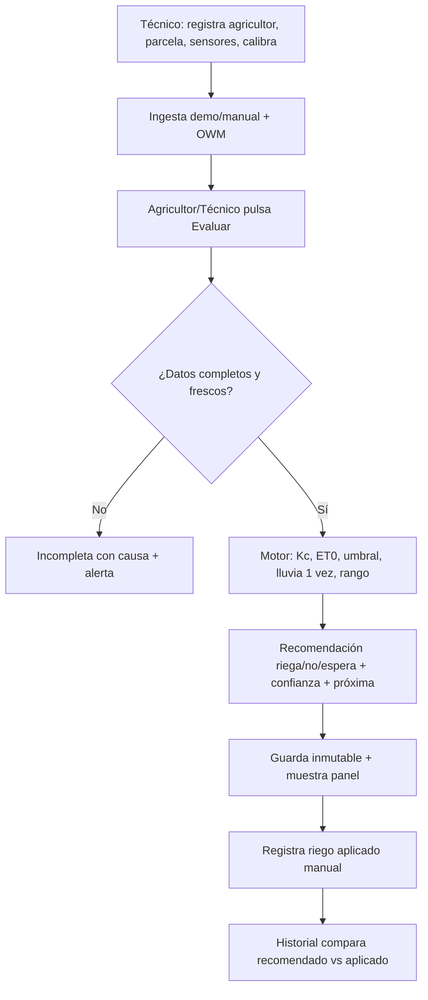
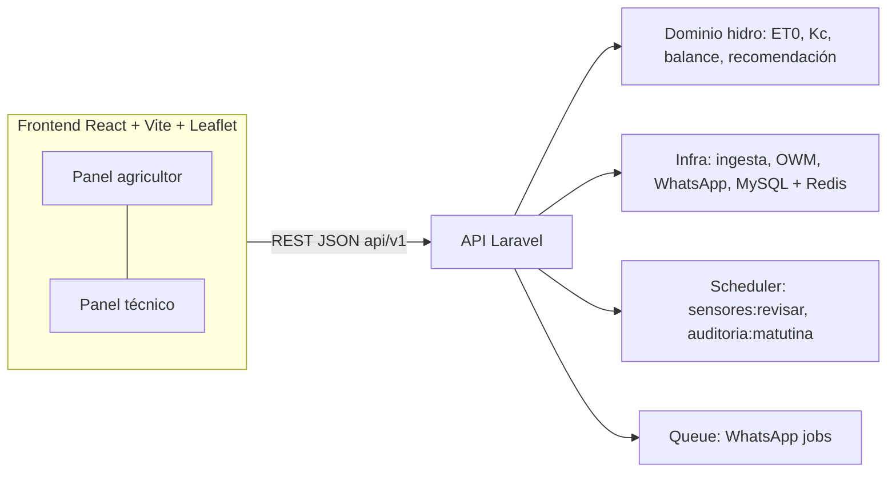
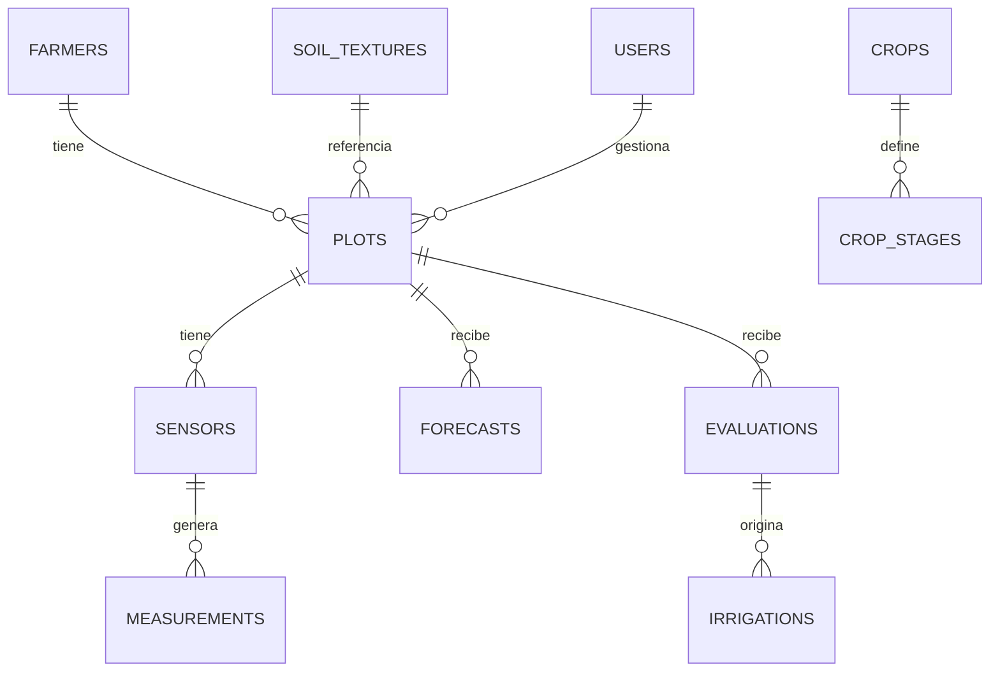
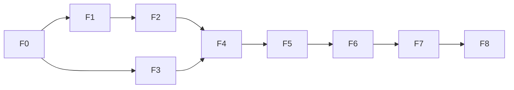

# YakuAI — Sistema de apoyo a la decisión de riego

> Documento maestro del proyecto. Estado de cada elemento:
> **Definido** (decidido) · **Propuesto** (planteado, sin implementar) ·
> **Pendiente** (falta decidir) · **Implementado** (solo con código que lo respalda).

## 1. Nombre y descripción

**YakuAI**. Sistema de apoyo a la decisión de riego para agricultura familiar
(Chupaca, Junín): combina parcela + cultivo/suelo + sensores Arduino baratos +
pronóstico OpenWeatherMap y produce una recomendación explicable (regar / no
regar / esperar + cantidad en rango + momento + confianza + próxima revisión).
El sistema recomienda; el agricultor decide y riega.

## 2. Problema, objetivo y alcance

**Problema (Definido):** regar a ojo desperdicia agua o estresa el cultivo;
la humedad sola, sin suelo, etapa, clima y riego anterior, no alcanza para
decidir bien.

**Objetivo (Definido):** responder "¿riego ahora o en las próximas horas y
cuánta agua conviene aplicar?" con trazabilidad de lo usado para decidir.

**Alcance v1 curso-maqueta (Definido):** 4 cultivos (papa, maíz choclo, haba
seca, zanahoria); 3 sensores lógicos (YL-69, FC-37, DHT11) con ingesta
manual/demo y Arduino después; OWM con key de servidor; mapa con área del
dibujo; panel agricultor simple + panel técnico; riego aplicado manual;
notificación en panel + WhatsApp automático (configurable).

**Fuera de v1 (Definido):** NPK→litros, mapa→suelo, válvulas, IA predictiva,
multipunto, Penman-Monteith completo, SMS automático.

## 3. Usuarios objetivo

Agricultores de pocos conocimientos técnicos (solo ven y deciden) y técnico de
campo + administrador del curso (configuran todo). Supervisor y soporte son
fase real futura, no v1.

## 4. Funcionalidades principales (requisitos funcionales)

| # | Funcionalidad | Estado |
|---|---|---|
| F1 | Auth por rol + PIN agricultor (4 dígitos por cuenta) | Implementado |
| F2 | CRUD agricultores y parcelas (wizard 3 pasos, área del dibujo) | Implementado |
| F3 | Catálogos versionados: cultivos/etapas (Kc, días, Zr, p), suelos (CC/PMP) | Implementado |
| F4 | Sensores: registro, calibración 2 puntos, estado, ingesta `POST /measurements` | Implementado |
| F5 | Clima OWM por lat/lon con raw, vigencia 3 h, fallback demo | Implementado |
| F6 | Motor: edad→Kc→ET0 Hargreaves→ETc→umbral→lluvia efectiva 1 vez→rango 50 L + confianza | Implementado |
| F7 | Botón Evaluar con idempotencia parcela+hora, evaluación inmutable con snapshot | Implementado |
| F8 | Riego aplicado manual + historial recomendado vs aplicado | Implementado |
| F9 | Alertas en panel (sensor 3 h, anomalía, lluvia alta) + WhatsApp automático | Implementado |
| F10 | Reporte curso: 10 casos demo + tabla de aciertos | Implementado |
| F11 | Auditoría matutina automática (5:30 AM) con evaluaciones + WhatsApp | Implementado |

Requisitos no funcionales: frontend React con build Vite; respuesta
evaluar < 2 s en local; funciona con datos demo sin internet salvo OWM;
español; datos con fecha/hora UTC y vista America/Lima.

## 5. Casos de uso y flujo principal



Flujo de excepción: sensor callado 3 h → degradado; valor imposible →
cuarentena; doble envío → misma evaluación; OWM falla → incompleta por clima.

## 6. Reglas de negocio (Definido)

1. Sin CC/PMP/Zr/p/Kc/área/edad → incompleta ("dato pendiente"), no inventar.
2. Lectura > 30 min o clima > 3 h → vencidos.
3. YL-69: >850 seco, 500-850 húmedo, <500 mojado (calibrable).
4. FC-37 solo aviso sí/no (no da mm). HR del DHT11 solo se muestra; su
   temperatura alimenta ET0.
5. Lluvia solo pospone si prob ≥ 70 % + mm que cubren lo que falta, en 2
   bloques seguidos, espera 6 h; si suelo crítico, se riega igual.
6. Salida en rango de 50 L + momento 05:30-07:00 + confianza por frescura +
   próxima hora. Haba = seca. MO por defecto 1 %.

## 7. Roles y permisos (Definido)

| Rol | Ve | Crea/edita | Restricción |
|---|---|---|---|
| Admin | Todo | Usuarios, catálogos, todo | Solo él toca parámetros FAO |
| Técnico | Sus parcelas, sensores, clima, historial | Agricultores, parcelas, sensores, riegos | No toca catálogos ni usuarios |
| Agricultor (PIN) | Solo sus parcelas | Evaluar, registrar su riego | No configura |
| Sensor (token) | Nada | Solo `POST /measurements` | Alcance ingesta |

## 8. Arquitectura (Implementado)



Servicios Docker (Implementado): `mysql:8.4, redis:7-alpine, app (PHP 8.3-FPM),
nginx, frontend (node:22)`. Curso enciende 5 con `docker compose up -d
--build`; `scheduler` y `worker` llevan `profiles: [produccion]` y solo
encienden con `docker compose --profile produccion up -d --build`.

Componentes y responsabilidades: `frontend/` solo presenta; `backend/` valida/auth/
orquesta; `backend/app/Services/` concentra la lógica testeable sin HTTP;
MySQL/Redis vía `backend/config/`. Fórmulas nunca en pantallas.

## 9. Stack (Implementado)

| Decisión | Opciones | Elegida | Motivo |
|---|---|---|---|
| Backend | Laravel / Express / FastAPI | **Laravel API + MySQL + Redis** | Conocimiento del equipo y trazabilidad |
| Frontend | React / HTML estático | **React + Vite + Leaflet** | Panel agricultor/técnico + mapa sin key |
| Clima | OWM Current+5d/3h free | **La misma** | 1.000 consultas/día bastan; key solo servidor |
| Auth | Sesión / JWT+PIN | **JWT corto + PIN 4 dígitos** | Simple para agricultor, revocable |
| WhatsApp | Twilio / Meta Business / Ninguna | **Meta Business API (configurable)** | Gratuito para agricultores, amplio alcance |

Puerta real sin retrabajo: dominio separado, `api/v1` versionado y snapshot
por evaluación; a futuro se suman workers, PostGIS/WA real e ingesta LoRa/GSM.

## 10. Estructura (Implementado)

```text
yakuai/
  README.md  RESUMEN.md
  backend/ (app/, routes/api.php, database/migrations, tests/)
  frontend/ (src/, Leaflet para mapa)
  docker/ (php/Dockerfile, nginx/default.conf, frontend/Dockerfile)
  docker-compose.yml  .env.example  scripts/
  docs/ (ARDUINO.md)
```

## 11. Base de datos (Implementado, MySQL 8.4)



Tablas: `users, farmers, crops, crop_stages, soil_textures, plots, sensors,
measurements, forecasts, evaluations, irrigations`.
Índices (plot, fecha); unicidad (sensor+measured_at) y (plot+evaluated_at/hora).

## 12. APIs (Implementado, prefijo `/api/v1`, Sanctum)

| Método | Ruta | Auth | Uso |
|---|---|---|---|
| POST | /auth/login (técnico/admin) | — | JWT |
| POST | /auth/pin | — | PIN agricultor → JWT limitado |
| GET | /auth/me | JWT | Info usuario actual |
| POST | /auth/logout | JWT | Cerrar sesión |
| CRUD | /users | Admin | Gestión usuarios |
| GET | /crops, /soil-textures | JWT | Catálogos |
| CRUD | /farmers, /plots, /sensors | JWT rol | Gestión |
| POST | /measurements | Token sensor o JWT | Ingesta |
| GET | /plots/{id}/weather | JWT | Último pronóstico |
| POST | /plots/{id}/weather/refresh | Técnico | Actualiza OWM |
| POST | /plots/{id}/evaluate | JWT | Idempotente parcela+hora |
| GET | /evaluations, /evaluations/{id} | JWT | Historial |
| GET | /evaluations/{id}/mensaje | JWT | Texto WhatsApp |
| POST | /irrigations, /irrigations/{id}/corregir, /irrigations/{id}/anular | JWT | Riego aplicado |
| GET | /alerts | JWT | Alertas |
| GET | /validation | Técnico | Matriz validación |

## 13. Variables de entorno y puertos (Implementado)

Puertos: panel `127.0.0.1:8081` (`FRONTEND_PORT`),
API `127.0.0.1:8082` (`API_PORT`). Fuente de verdad: `.env` / `.env.example`.

`DB_HOST/DB_PORT/DB_DATABASE/DB_USERNAME/DB_PASSWORD, REDIS_HOST,
OWM_KEY (solo servidor, nunca repo), OWM_TIMEOUT,
WHATSAPP_API_URL, WHATSAPP_API_KEY, WHATSAPP_PHONE_NUMBER_ID,
CORS_ALLOWED_ORIGINS, TZ=America/Lima`.

## 14. Testing, seguridad, rendimiento (Implementado)

Tests: `php artisan test` (PHPUnit, 48+ tests) para auth, catálogos,
parcelas con scoping por agricultor, ingesta y clima + tests
frontend (Vitest + React Testing Library) +
10 casos demo como fixtures + checklist manual de paneles y mapa.
Seguridad: secretos solo servidor, PIN con bloqueo por intentos, token
sensor solo ingesta, evaluaciones inmutables, CORS configurado,
rate limiting en login/PIN.
Rendimiento: MySQL + paginación; `scheduler/worker` con perfil produccion.

## 15. Convenciones (Implementado)

Español, unidades mm/L/m², fechas UTC con vista Lima, dinero no aplica,
código con Pint (backend) y oxlint + tsc (frontend), commits convencionales, ramas
`main` + `feat/*`.

## 16. Roadmap (Implementado)

**F0 Entorno y contratos.** Objetivo: base que no se rehace. Tareas: compose
(7 servicios, 5 encendidos + scheduler/worker con perfil produccion),
`.env.example` (puertos 8081/8082, DB, Redis, OWM_KEY), contratos
`POST /measurements` y snapshot de evaluación, fixtures de 10 casos. Bloquea
todo. Aceptación: `up -d --build` levanta 5 saludables y contratos
documentados.
Estado: **Implementado**.

**F1 Catálogos, usuarios, parcelas y mapa.** Usuarios+PIN, cultivos/etapas,
suelos, wizard parcelas, Leaflet punto+contorno con área auto. Paralelizable:
catálogos y mapa. Aceptación: crear parcela con área del dibujo confirmada.
Estado: **Implementado** (auth login/PIN, 4 cultivos + 16 etapas + 5 suelos
seed, farmers/plots API, panel login/agricultores/parcelas con mapa).

**F2 Ingesta.** Sensores+calibración 2 puntos, `POST /measurements` con
validación rango/duplicado/frescura y estados ok/sin_datos/anómalo.
Aceptación: YL-69 250 % va a cuarentena; 3 h sin datos genera alerta.
Estado: **Implementado** (sensores CRUD, normalizador YL-69/DHT11/FC-37,
duplicados 409, comando `yakuai:sensores:revisar`, página sensores con carga
manual, scoping agricultor + jaula token sensor).

**F3 Clima.** Integración OWM con caché, raw y vigencia 3 h + modo demo con
mismo esquema. Requisito previo: key activa (**Pendiente**).
Aceptación: pronóstico vencido → incompleta por clima.
Estado: **Implementado** (ventana 6 h agregada, fallback demo/owm_fallo sin
romper, página clima con vigencia y origen).

**F4 Motor.** Dominio puro + 35+ tests unitarios (matriz papa + 3 niveles
lluvia + crítico nunca espera). Aceptación: casos demo dan rangos esperados.
Estado: **Implementado** (HydroService ET0 Hargreaves + Ra FAO, umbral,
espera 6h, rango 50L, idempotencia por hora, 14 tests verdes).

**F5 Evaluar + paneles.** Botón idempotente, tarjetas agricultor/técnico,
textos de recomendación definidos. Aceptación: doble clic = 1 evaluación.
Estado: **Implementado** (página Evaluar con tarjeta, colores, historial).

**F6 Riegos e historial.** Registro manual, corrección con motivo,
comparativa y alertas en panel. Aceptación: recomendado vs aplicado visible.
Estado: **Implementado** (cadena supersede/anulación, alertas calculadas
sensores+incompletas+críticos, páginas Riegos y Alertas).

**F7 Validación curso.** Correr 10 casos, tabla de aciertos, informe con
citas FAO. Aceptación: matriz verde + README marcado.
Estado: **Implementado** (endpoint + página validación 10/10).

**F8 Cierre y puerta real.** WhatsApp automático, auditoría matutina,
guía Arduino. Aceptación: mensajes enviados + auditoría 5:30 funcional.
Estado: **Implementado** (WhatsApp service configurable, auditoría matutina
real con jobs, `docs/ARDUINO.md`).



## 17. Definition of Done

Funcionalidad lista cuando: implementada + tests + validaciones +
lint/build verdes + sin secretos en repo + migraciones + docs/contratos
actualizados + criterios de aceptación cumplidos + sin bugs críticos.
Proyecto listo cuando F0-F8 en verde y el informe cita las 4 fuentes.

## 18. Riesgos y decisiones pendientes

Riesgos: key OWM inactiva (mitigar: demo con mismo esquema); YL-69 deriva
(mitigación: recalibración + capacitivo en real); pronóstico fallido con
suelo crítico (mitigación: nunca esperar si crítico); celular compartido
(mitigación: PIN por cuenta).
**Pendientes:** key OWM activación, key WhatsApp Business configuración.
Stack Laravel+React y puertos 8081/8082 decididos.
