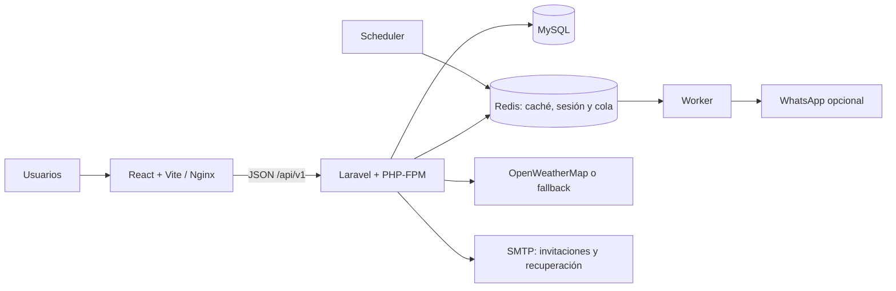

# Arquitectura general

YakuAI se compone de una aplicación React, una API Laravel y servicios de persistencia y soporte. En desarrollo Docker Compose monta el código y Vite sirve el frontend; en producción se compilan imágenes y Nginx sirve los recursos estáticos y deriva las solicitudes de API.

## Componentes

- **Frontend:** React 19, TypeScript, Vite, React Router, Tailwind CSS, Leaflet y componentes compartidos.
- **Backend:** PHP 8.3, Laravel 13, Sanctum y endpoints JSON bajo `/api/v1`.
- **Datos:** MySQL 8.4; el esquema se construye con migraciones y datos de catálogo/escenarios mediante seeders.
- **Redis:** caché, sesiones y cola según configuración Compose.
- **Servicios externos:** OpenWeatherMap y SMTP; WhatsApp Cloud API de forma opcional mediante el servicio implementado.

La relación de entidades se describe en [modelo de datos](modelo-de-datos.md); los puertos y comandos se encuentran en [desarrollo local](../operacion/desarrollo-local.md) y [despliegue](../operacion/despliegue-produccion.md).
