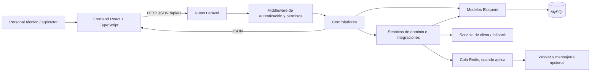
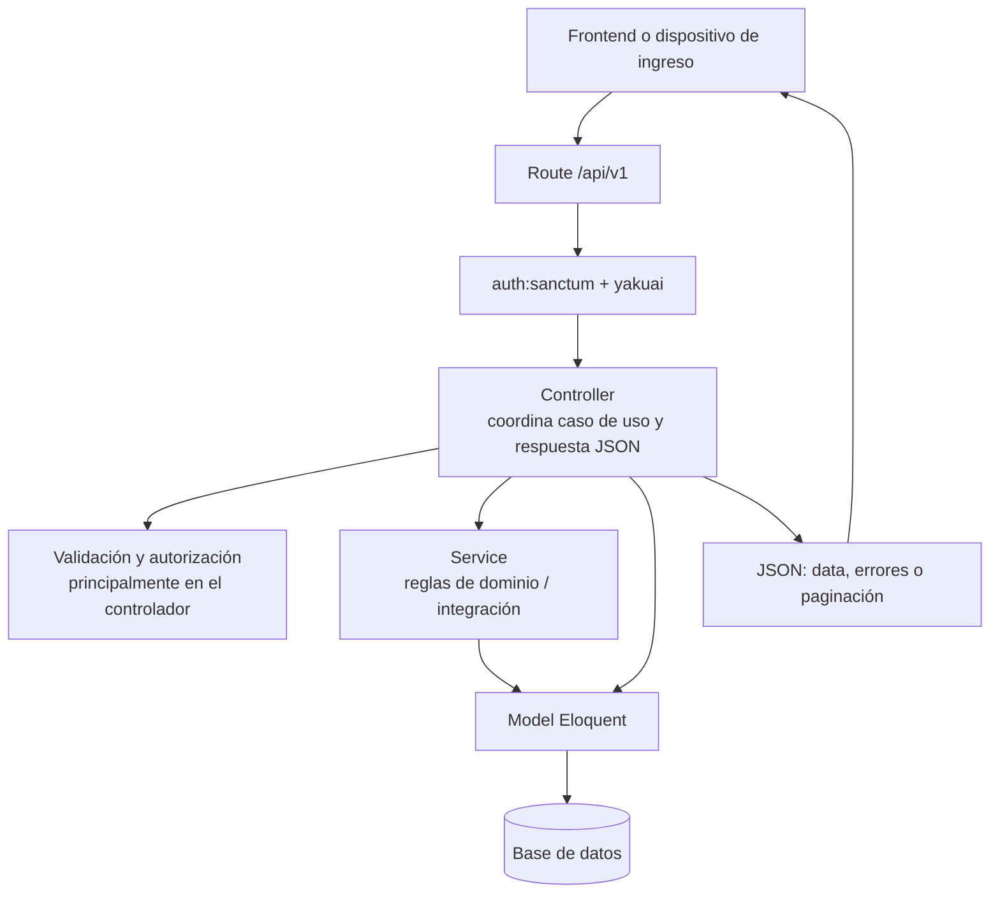
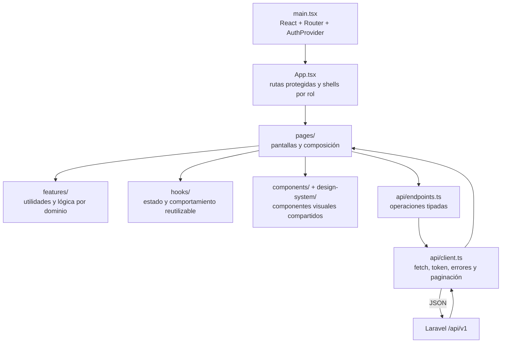
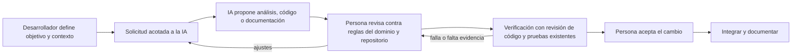
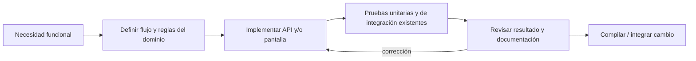

# Diagramas de desarrollo

Estos diagramas resumen la arquitectura y las prácticas que se pueden observar en el repositorio. No representan un historial de cada decisión ni reemplazan las rutas, el código y las pruebas como fuente de verdad.

## Flujo general del sistema

La interfaz presenta la recomendación, pero el cálculo y la autorización se ejecutan en Laravel. La persona usuaria decide y aplica el riego; el sistema no acciona válvulas.

## Backend: MVC de Laravel con servicios de dominio

**Cómo clasificarlo:** es una aplicación monolítica Laravel organizada con el patrón MVC y una capa adicional de servicios. Las rutas dirigen la petición; los controladores coordinan; los modelos Eloquent representan y consultan datos; servicios como `HydroService`, `OwmService` y `SensorNormalizer` concentran lógica de dominio o integración. La validación observada se hace con `$request->validate()` en los controladores; el repositorio no muestra una capa general de Form Requests para estos flujos.

## Frontend: organización por funcionalidades y componentes

**Cómo clasificarlo:** frontend React/TypeScript modular, orientado a funcionalidades y con componentes reutilizables (no MVC). Las páginas componen pantallas; `features/` agrupa código específico de cada dominio; `hooks/` reutiliza comportamiento; `design-system/` y `components/` comparten patrones visuales. Un cliente HTTP central agrega el token Sanctum y normaliza respuestas y errores. La aplicación separa experiencias de personal técnico y agricultores mediante rutas y shells por rol.

## Ciclo de desarrollo asistido por IA

Este es un **flujo recomendado para documentar el uso de IA**, no una afirmación de que todos los cambios del proyecto se hayan producido así. El repositorio inspeccionado no registra qué asistente, modelo o prompts se usaron, ni conserva un historial de revisión humana por cambio; por ello no es posible verificar retrospectivamente la metodología real de IA. La IA debe apoyar el trabajo, mientras que las reglas de riego, permisos, datos y aceptación quedan bajo revisión humana. En el producto actual, “YakuAI” no significa que haya un modelo generativo integrado: las recomendaciones de riego se calculan con reglas deterministas en el backend.

## Ciclo de entrega que se desprende del repositorio

El repositorio contiene pruebas PHPUnit y Vitest, además de comandos de build y lint. El diagrama refleja un ciclo de trabajo compatible con esos artefactos; no demuestra que cada contribución histórica haya seguido exactamente esos pasos.
